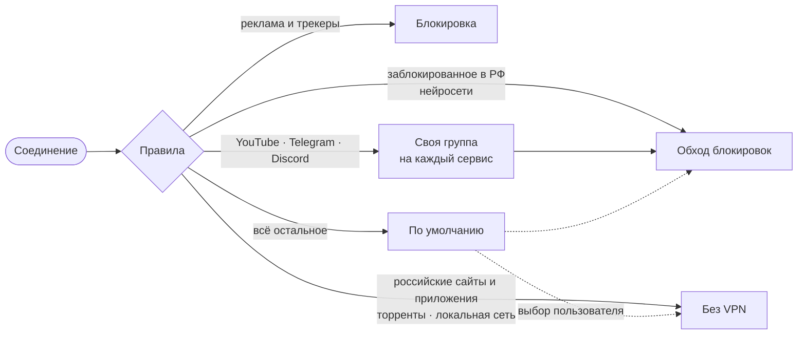

<div align="center">

<p>
  &nbsp;&nbsp;
  &nbsp;&nbsp;
  &nbsp;&nbsp;
  &nbsp;&nbsp;
  
</p>

# mihomo-routing

**Маршрутизация для [mihomo](https://github.com/MetaCubeX/mihomo) под Россию**<br>
заблокированное — через прокси, остальное — напрямую

[](https://github.com/kwlnd/mihomo-routing/actions/workflows/build.yml)


</div>

<br>

> [!NOTE]
> Сделано для себя и выложено как есть, без гарантий. Берите, правьте под себя.

## Как идёт трафик



## Группы

| | Группа | Что туда попадает |
|:-:|---|---|
|  | **Обход блокировок** | Re:filter, списки ITDog, нейросети, свои домены из `lists/proxy.txt` |
|  | **YouTube** | домены и приложение YouTube |
|  | **Discord** | домены, голосовые серверы и приложение |
|  | **Telegram** | домены, подсети и клиенты Telegram |
|  | **По умолчанию** | всё, что не попало в правила; из коробки идёт напрямую |

## Быстрый старт

1. Возьмите [`routing.yaml`](routing.yaml).
2. Это шаблон для **Remnawave**: серверы в группу «Автовыбор» подставляет панель. Без панели впишите свои прокси в `proxies` и в эту группу.
3. Замените пароль и загрузите конфиг в клиент.

> [!IMPORTANT]
> В конфиге стоит заглушка `user:CHANGE_ME` в `authentication`. Поменяйте её на свои логин и пароль: это доступ к прокси из локальной сети.

## Свои домены

Допишите строку в нужный файл и запушьте — список пересоберётся сам за минуту.

| Файл | Куда идёт |
|---|---|
| [`lists/proxy.txt`](lists/proxy.txt) | через прокси |
| [`lists/direct.txt`](lists/direct.txt) | напрямую |
| [`lists/telegram.txt`](lists/telegram.txt) | в группу Telegram |

```text
+.example.com    домен со всеми поддоменами
example.com      только точное совпадение
```

## Как это устроено

| Ветка | Содержимое |
|---|---|
| [`main`](https://github.com/kwlnd/mihomo-routing/tree/main) | конфиг, исходники своих списков, скрипты сборки |
| [`release`](https://github.com/kwlnd/mihomo-routing/tree/release) | собранные списки `.mrs`, перезаписывается раз в сутки |
| [`assets`](https://github.com/kwlnd/mihomo-routing/tree/assets) | иконки групп и фоны для FlClashX |

GitHub Actions раз в сутки скачивает списки из первоисточников, пакует их ядром mihomo и кладёт в `release`. Если источник недоступен или отдал мусор, остаётся прошлая версия файла, а сборка помечается упавшей.

<details>
<summary><b>Источники списков</b></summary>
<br>

| Список | Источник |
|---|---|
| Заблокированные домены | [Re:filter](https://github.com/1andrevich/Re-filter-lists), [itdoginfo/allow-domains](https://github.com/itdoginfo/allow-domains) |
| Реклама и трекеры | [OISD](https://oisd.nl) |
| Торрент-трекеры | [sakib-m/Pi-hole-Torrent-Blocklist](https://github.com/sakib-m/Pi-hole-Torrent-Blocklist) |
| Российские приложения, торрент-клиенты | [legiz-ru/sb-rule-sets](https://github.com/legiz-ru/sb-rule-sets) |
| Геосписки сервисов | [MetaCubeX/meta-rules-dat](https://github.com/MetaCubeX/meta-rules-dat) |
| Российские домены и адреса | [Davoyan/mihomo-rule-sets](https://github.com/Davoyan/mihomo-rule-sets) |

Последние два подключаются напрямую из их репозиториев, остальные пересобираются здесь.

</details>

<br>

<div align="center">
<sub>Конфиг вырос из шаблона сообщества Remnawave. Спасибо авторам списков.</sub>
</div>
